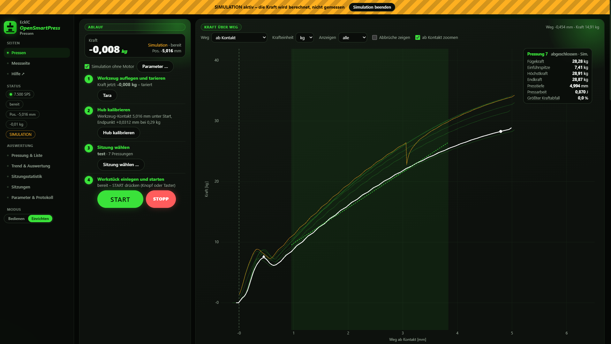
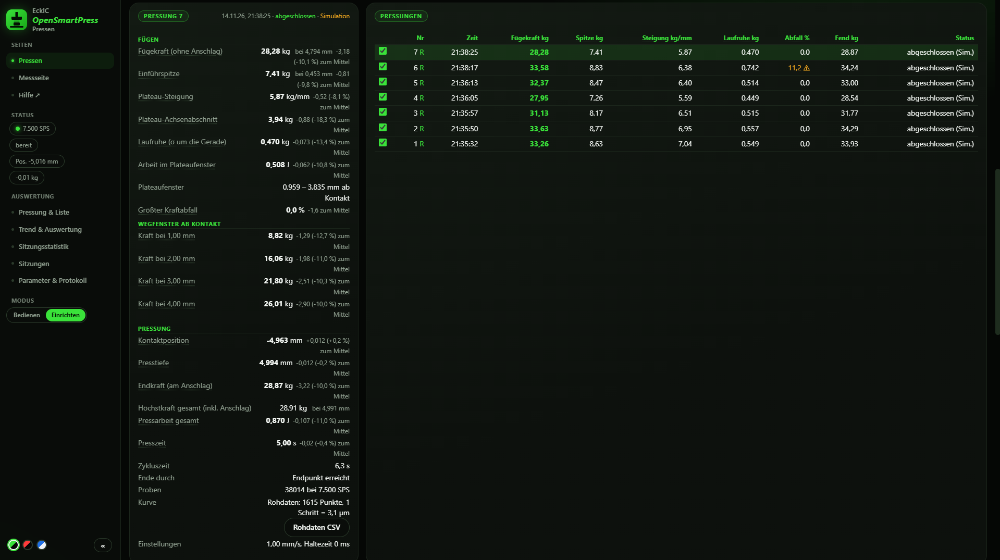
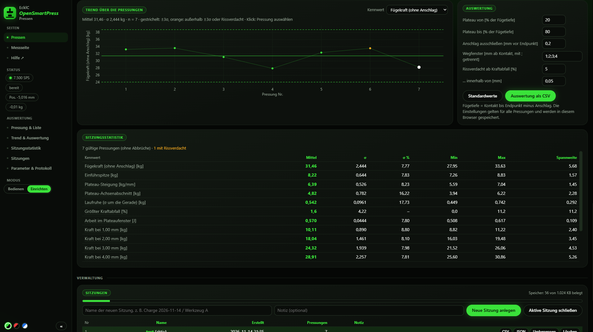
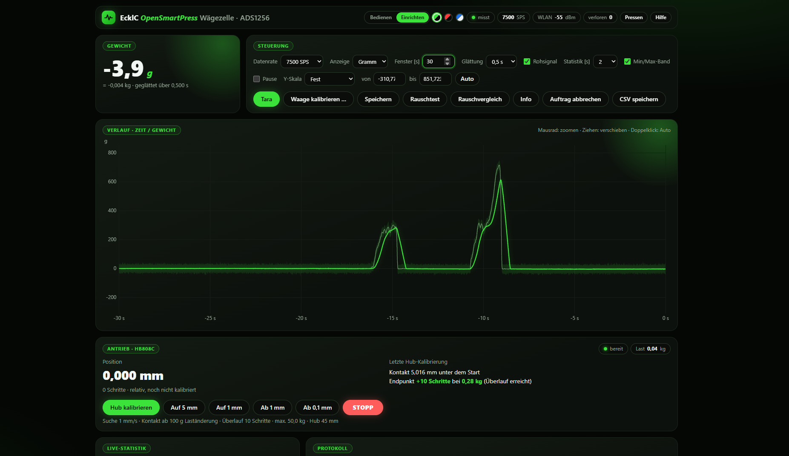

# OpenSmartPress

**English** · [Deutsch](README.md)

Precise force and weight measurement with a 50 kg load cell, a 24-bit **ADS1256** ADC and a
**Raspberry Pi Pico W**. Readings appear live in the browser over WLAN and on the PC over USB.
Data rates from 2.5 to 30 000 samples per second can be switched during operation.

> Status: test setup. Firmware and web interface work; settings and limits are tailored to the setup
> described below.

**Video:** OpenSmartPress in action (click the image to open YouTube)

[](https://www.youtube.com/watch?v=wHO0QPex5B8)

## Features

- **Continuous ADS1256 operation** (RDATAC) with a DRDY interrupt on a dedicated processor core, SPI at 1.9 MHz,
  ring buffer for 4096 samples. Lost samples are counted and displayed.
- **Web interface** served directly by the Pico: weight display, live time/weight chart with min/max band,
  live statistics, log and command line, in **German or English** (switch DE/EN). Explanations and tuning tips are
  in [help.en.md](help.en.md).
- **Smoothing** as a moving average over a freely selectable time (0–60 s), independent of the data rate.
- **Tare and calibration** with plausibility check (sensitivity in mV/V, uncertainty of the factor).
- **Noise analysis**: standard deviation in counts, µV and grams, effective and noise-free resolution,
  scatter after averaging to 10 SPS. `nv` compares several data rates automatically.
- **Monitoring**: warning from 100 % rated load, alarm from 120 % (LED), detection of a clipped ADC.
  A sensor fault (reading at the limit or frozen) stops and blocks every downward move.
- **PC program** `tools/waegezelle_plot.py` for recording every single sample over USB.
- Settings (tare, factor, smoothing, data rate, drive) are stored in flash, safe against power loss,
  in the file `/einst.bin` (LittleFS).

## Hardware

| Part | Type / value |
|---|---|
| Microcontroller | Raspberry Pi Pico W or WH (RP2040) |
| ADC | ADS1256 module, 7.68 MHz crystal, ADR03 reference (2.5 V), 5 V supply, 3.3 V logic |
| Load cell | 50 kg, flat diaphragm, 350 Ω full bridge, 1.0–2.0 mV/V |
| Bridge excitation | 5.00 V from an LT3042 (low-noise linear regulator) |

Datasheet values of the parts and what they mean for this setup: [docs/hardware.en.md](docs/hardware.en.md).

### Wiring

Diagram: [docs/Verdrahtung_PicoWH_ADS1256.svg](docs/Verdrahtung_PicoWH_ADS1256.svg)

| Pico | ADS1256 | Function |
|---|---|---|
| GP18 | SCLK | SPI0 clock |
| GP19 | DIN | SPI0 TX |
| GP16 | DOUT | SPI0 RX |
| GP17 | CS | chip select (as GPIO) |
| GP20 | DRDY | data ready |
| GP21 | PDWN | power-down (optional) |
| VBUS / GND | 5V / GND | supply |

| Load cell | Connection |
|---|---|
| Red | +5.00 V (LT3042) |
| Black | GND |
| Green | AIN0 |
| White | AIN1 |

Differential measurement AIN0–AIN1, input buffer on, PGA 64: range ±78.125 mV, 1 count = 9.313 nV.

### Drive

Nema 23 closed-loop stepper motor with **HB808C** driver (PUL/DIR, 24–80 V, signal inputs 4.5–28 V), stroke 45 mm,
"down" (`ab`) = clockwise.

| Pico | Connection | Note |
|---|---|---|
| GP2 | PUL | via a 5 V level shifter (e.g. 74AHCT125) or transistor, 3.3 V is not enough |
| GP3 | DIR | like PUL |
| GP4 | ENA | recommended (`mp ena`), route through the emergency stop circuit |
| GP5 | ALM | optional, alarm output of the driver (`mp alm`) |
| GP6 | START push-button to GND | starts a press (when everything is ready) |
| GP7 | STOP push-button to GND | stops immediately (software, not an emergency stop) |
| GP10 / GP11 | encoder EA+ / EB+ (test command `enc` only) | each via a 10 kΩ / 20 kΩ voltage divider to GND (5 V → 3.3 V), GND to EGND; disconnect after the test |

A Nema 23 on a spindle can push many times the 50 kg rated load. The force limit in the Pico is fast, but it does
not replace an **emergency stop** or a mechanical end stop.

**Emergency stop (mandatory for operation):** The STOP push-button on GP7 is polled by the firmware. If the firmware
hangs, or core 1 is busy with the ADC (self-calibration, up to about 3 s), it has no effect. An emergency stop must
therefore be **hard-wired** and independent of the Pico (EN ISO 13850, design according to EN ISO 13849-1):

- Emergency stop button (latching, normally closed, positive opening) in series with the coil of a safety relay or
  contactor.
- The contactor disconnects the supply of the HB808C (24–80 V). Additionally route ENA through a second normally closed
  contact so that the driver is disabled even if the contactor welds; then set `mp ena 1` or `2` in the firmware.
- After unlatching, the motor must not start by itself: the contactor only picks up again via a separate
  enable button (self-holding). Then recalibrate the stroke, the position is unknown.
- Without ENA, the firmware reminds you of this on the first move after power-up.

**For low noise:** supply the ADS1256 module from the LT3042 as well, star ground at the ADS1256's AGND,
twist the green/white signal wires and keep them away from the Pico. You can measure the influence of the WLAN radio
with `wlan aus` / `wlan an` and a noise comparison.

## Software setup

1. Install the **Arduino IDE** and add the core **"Raspberry Pi Pico/RP2040/RP2350" by Earle Philhower**
   via the boards manager (developed with version 6.3.2). No other libraries are needed.
2. Clone the repository. The folder must be named `Waegezelle_Test` so that the Arduino IDE opens the sketch.
   ```
   git clone https://github.com/EggCe/OpenSmartPress.git Waegezelle_Test
   ```
3. Copy `wlan_zugang.beispiel.h` to **`wlan_zugang.h`** and enter SSID and password
   (2.4 GHz networks only). This file is not committed to the repository.
4. Open `Waegezelle_Test.ino`, select board **"Raspberry Pi Pico W"** and under *Tools → Flash Size*
   **"2MB (Sketch: 1MB, FS: 1MB)"**, then upload. The file system holds the sessions; stored settings are kept
   when switching. With arduino-cli:
   ```
   arduino-cli compile --upload -p COM5 --fqbn rp2040:rp2040:rpipicow:flash=2097152_1048576 .
   ```
5. Open the serial monitor (line ending "New Line"). After start-up the address of the web interface appears:
   ```
   # WLAN verbunden: http://192.168.x.x  bzw. http://waegezelle.local
   ```

Serial monitor messages and commands are German (e.g. `wlan aus` = WLAN off, `sit neu` = new session); the tables
below explain each command in English.

## Operation

### Web interface

| Address | Content |
|---|---|
| `http://waegezelle.local/presse` | **Press page** (production): procedure, force-path chart, indicators, sessions |
| `http://waegezelle.local/` | Measurement page (service): weight, chart, statistics, log, commands |

If `waegezelle.local` does not work, use the IP address from the serial monitor. The pages are stored in the
Pico's flash and need no internet. The "Help" button opens [help.en.md](help.en.md) (or the German
[help.md](help.md)) on GitHub (this needs internet): every control and figure explained, tuning tips, calibration.

**Language:** both pages have a **DE / EN** switch (measurement page top right, press page in the left menu). The
choice is stored in the browser and applies to both pages; without a choice the browser language decides. Switching
is instant and does not reload the page, so it also works while the drive is moving. Number and date formats follow
the language, and so do the browser's CSV exports (German: `;` and decimal comma, English: `,` and decimal point).
The log, the Pico's feedback messages and the server-side session export (`/sitzung/export`) stay German.

Both pages have the **Operate / Setup** view (stored in the browser, new browser = Operate):
Operate shows only tare, calibrate stroke, session, START/STOP, chart and analysis; Setup additionally shows
data rate, noise tests, calibrate scale (dialog), save, jog mode, simulation, press parameters
(incl. max. force/contact), log and command line. No access protection. While the drive is moving, a STOP bar
appears at the bottom; responses and errors of the Pico briefly appear at the bottom right; without a connection a
red bar locks the command buttons (except STOP).

**Press page – procedure and force-path chart** (here in simulation, aligned from contact, with
plateau window, plateau line and one press with suspected crack):



**Press page – indicators of the selected press and list of all presses of the session:**



**Press page – trend of an indicator with ±3σ, analysis settings, session statistics and sessions:**



**Measurement page – weight, controls, time/weight history with min/max band and drive:**



(The screenshots show the German interface.)

**Recommended basic settings for weighing:** 2000 SPS, smoothing 0.5 s, statistics 2–5 s.

### First steps

1. Let the device warm up for 15–30 minutes.
2. Unload the cell, press **Tare** (or `t`).
3. Place a known weight in the centre, preferably 5 kg or more, then calibrate: `k 5000 10000`
   (weight in grams, number of samples).
4. Save with `s`.

### Commands

In the input field of the web interface or in the serial monitor. `h` shows all commands.

| Command | Function |
|---|---|
| `t [n]` | tare from n samples |
| `k <g> [n]` | calibrate with a known weight in grams |
| `f <c/g>` | set the calibration factor directly (counts per gram) |
| `r <sps>` | data rate: 2.5 5 10 15 25 30 50 60 100 500 1000 2000 3750 7500 15000 30000 |
| `fl <s>` | smoothing in seconds (0 = off) |
| `ws <s>` | duration of the live statistics on the web |
| `n [n]` | noise analysis |
| `nv [s] [sps …]` | noise comparison of several data rates |
| `m <0..4>` | USB output: 0 off, 1 readable, 2 CSV, 3 Arduino plotter, 4 binary |
| `wlan [an\|aus]` | WLAN status or switch on/off (`an` = on, `aus` = off) |
| `wd` / `wd test 0\|1` | watchdog status / hang core 0 or 1 for a test (triggers a restart) |
| `enc` / `enc 0` / `enc aus` | encoder test: count the quadrature on GP10/GP11 (1 revolution = 4 × line count) / zero the counter / stop (`aus` = off) |
| `i` / `d` / `c` | status / ADS1256 registers / ADC self-calibration |
| `s` | save settings to flash |
| `x` | cancel the running job |
| `init` | re-initialise the ADS1256 |
| `w ja` | factory settings (deletes tare and calibration; `ja` = yes) |

### Setting up the drive and calibrating the end point

1. Set `mp spmm <steps per mm>` (microsteps per revolution × gear ratio / spindle pitch, e.g. 320).
   The motor does not move before that.
2. Scale calibrated, data rate 2000 SPS. Below 500 SPS or without a calibrated factor the drive does not move.
3. Check the direction: `mot ab 1` must move down, otherwise `mp dir 0`/`1`. Verify the distance with `mot ab 10`.
4. First moves with a small force limit: `mp fmax 2000`. Save with `s`.
5. **End point calibration** (calibrate stroke) with the web button or `mot kal`, tool resting on the cell:
   - slowly down until the load rises by more than 100 g: **tool end point** = new zero point,
   - on to contact + 10 steps or 50 kg (whichever comes first): **actual end point**,
   - back to the start position, or with `mp kalrueck <mm>` to this many mm above the tool end point
     (0 = start position, never higher than that); contact depth, end point, force and stiffness are written to the log.

During every downward move, core 1 checks every sample in the ADC interrupt and stops within one step.
Stop at any time with `x`, the Esc key in the browser, the STOP button or the STOP push-button.

| Command | Function |
|---|---|
| `mot` | status, position, last calibration |
| `mot kal` | end point calibration (calibrate stroke) |
| `mot ab <mm>` / `mot auf <mm>` / `mot s <n>` | jog mode (`ab` = down, `auf` = up, `s` = steps) |
| `mot null` / `mot ein` / `mot aus` | set position 0, motor current on/off |
| `mp` / `mp <name> <value>` | show/set parameters: `spmm dir inv ena alm vsuch vfahrt acc hub ueber kontakt fmax kalrueck anfahrt vpress vanfahrt vrueck halt` |

### Pressing (production)

On the press page `http://waegezelle.local/presse`:

1. **Place the tool and tare** – the tool weight is subtracted.
2. **Calibrate stroke** (without workpiece, required after every power-up): tool end point = path 0, plus the
   actual end point (contact + `ueber` steps or `fmax`).
3. **Select or create a session.**
4. **Insert the workpiece, START** (button on the page, START push-button or `pr`): with `vanfahrt` (default 3 mm/s) to `anfahrt` mm
   (default 5, at most 10 mm; the path is limited by a stop screw on the press head) above the
   tool end point, with `vpress` to the **calibrated end point** (earlier at `fmax`), hold for `halt` ms, return with `vrueck` (default 3 mm/s).

Each press is drawn as a **force over path** curve and saved to flash immediately (about 200 presses).
All presses of a session are overlaid; clicking a curve or table row shows peak force, final force, contact,
press depth, mean force, standard deviation, range, press work and times, each with the deviation from the session
mean. The session statistics summarise mean, σ and range of all indicators.
Sessions can be created, opened, renamed, deleted and exported as **CSV** (Excel: semicolon, decimal comma) or
**JSON**. Aborted presses are saved with a mark and do not count towards the statistics.
**Analysis** (in the browser from the stored curves, settings on the page):
curves optionally aligned **from contact**; **joining force** without the end stop at the end point; **insertion peak**;
**plateau line** in an adjustable window (slope, intercept, **smoothness** = scatter around the line, work);
**largest force drop** marked as **suspected crack** (default from 5 % within 0.05 mm); **force in path windows** from
contact; **trend chart** of an indicator over the presses with ±3σ. "Analysis as CSV" exports everything.
In the simulation the curves have an insertion peak, and roughly every twelfth press gets a crack.

The **force unit** can be selected above the chart (**N, kg, lbs**) and applies to the chart, indicators, statistics
and CSV export; the browser remembers the choice. Data is always stored in N, the JSON export stays in N.

**Curve resolution:** The Pico stores at most 960 path segments over the press path (force averaged per segment).
If the press page is open during the press, the browser additionally fetches **every single sample**
(`GET /presse/roh`, every 100 ms; buffer in the Pico 4096 samples ≈ 2 s at 2000 SPS) and stores it in its
IndexedDB. From this it builds a curve with one point per motor step (e.g. 3.1 µm at 320 steps/mm), which is used
for the selected curve, the analysis and the "Raw data CSV" download (time, path, force, phase incl. hold time).
Presses with raw data are marked **R** in the table. Without raw data (page was closed,
WLAN gap longer than the buffer, other browser) the Pico curve applies. Details in
[help.en.md](help.en.md#curve-resolution).

**Simulation without motor:** `sim an` (or the switch on the press page). The step pulses go nowhere, the
position still counts; the force is calculated from the position: a virtual tool (default 15 mm below
the current position) and per press a virtual workpiece (default 3 mm high) with a random peak force
(default **25–35 kg**) plus noise. All values (press speed, tool distance, joining path, force range,
noise, crack rate, insertion peak) can be set in the **"Parameters …"** window next to the switch or with
`sim par` / `sim <name> <value>`; the browser remembers them, the Pico only until restart. ADC and load cell must be
connected (they provide the clock), `mp spmm` must be set, a calibration of the scale is not needed. Then calibrate
the stroke and press as usual. Simulated presses are marked in the table and export. The
simulation is off after every restart.

Requirements for START: ADC measuring at at least 500 SPS, scale calibrated, stroke calibrated since power-up,
session active, enough storage, drive above the end point. If something is missing, the page states the reason.

| Command | Function |
|---|---|
| `pr` / `pr x` | start / abort a press |
| `sim an` / `sim aus` | simulation without motor on/off (see above) |
| `sim par` / `sim <name> <value>` | simulation parameters: `werkzeug weg fmin fmax rauschen riss spitze` |
| `sit` | show sessions and storage usage |
| `sit neu <name>` / `sit wahl <no>` / `sit zu` | create / open / close a session |
| `sit loeschen <no> ja` | delete a session |
| `mp anfahrt <mm>` / `mp vpress <mm/s>` / `mp halt <ms>` | approach point (0–10 mm, default 5), press speed, hold time (then `s`) |
| `mp vanfahrt <mm/s>` / `mp vrueck <mm/s>` | pressing: approach to the approach point and return (0.1–50 mm/s, default 3 each) |

### Recording on the PC over USB

The web interface shows 50 aggregated points per second. For every single sample use the PC program.
It switches the firmware to binary mode and optionally records to a CSV file.

```
pip install pyserial numpy pyqtgraph PyQt5
python tools/waegezelle_plot.py                 # port is searched automatically
python tools/waegezelle_plot.py --port COM5 --rate 2000 --fenster 10
```

The serial monitor must be closed. Web interface and PC program can run at the same time.

## Example measurement: noise by data rate

Unloaded cell, PGA 64, factor 10.06 counts/g, 3 s each (command `nv 3 100 1000 2000`):

| SPS | σ single value | σ after averaging to 10 SPS | effective resolution |
|---:|---:|---:|---:|
| 100 | 25.9 counts (2.57 g) | 1.46 g | 19.3 bit |
| 1000 | 59.6 counts (5.92 g) | 1.03 g | 18.1 bit |
| 2000 | 76.2 counts (7.57 g) | 0.59 g | 17.8 bit |

At a high data rate every single value is noisier, but after averaging 2000 SPS was the most accurate.
The values depend strongly on the setup, supply and environment.

## Software structure

The two cores of the RP2040 share the work:

| Core | Tasks |
|---|---|
| Core 1 | All access to the ADS1256: initialisation, data rate, calibration, DRDY interrupt. Every sample goes into a ring buffer with a sequence number and time stamp. Also the drive: step generation via PWM, ramps, the end point calibration sequence, force monitoring in the ADC interrupt, push-buttons and alarm input. |
| Core 0 | Processing (smoothing, statistics, monitoring, tare/calibration), USB, WLAN and web server. Jobs for the ADC go to core 1 via a mailbox. |

In the arduino-pico core without FreeRTOS, WLAN code may only run on core 0, hence this split.

The program code is in `src/`; the Arduino IDE compiles this folder automatically. Identifiers and comments in the
code are German.

```
Waegezelle_Test/
├── Waegezelle_Test.ino        setup/loop (core 0) and setup1/loop1 (core 1)
├── wlan_zugang.beispiel.h     template for wlan_zugang.h (WLAN credentials)
├── src/
│   ├── konfig.h               pins, reference, rated load, limits
│   ├── adc.*                  ADS1256 object, mailbox core 0 → core 1, init, data rate
│   ├── verarbeitung.*         fetch samples, overload/clipping warning, DRDY timeout
│   ├── filter.*               smoothing (moving average over a time)
│   ├── statistik.h            Welford statistics, result of a noise measurement
│   ├── auftraege.*            tare, calibration, noise analysis, noise comparison
│   ├── usb_ausgabe.*          output modes readable/CSV/plotter/binary, #CFG line
│   ├── befehle.*              commands from serial monitor and web interface
│   ├── motor.*                drive on core 0: parameters, safety checks, messages
│   ├── einstellungen.*        settings in flash (/einst.bin, fallback EEPROM): tare, factor, drive
│   ├── meldung.*              messages to USB and web log
│   ├── pruefsumme.*           CRC-32 (flash) and CRC-8 (binary frame)
│   ├── rahmen.h               USB binary frame (mode 4)
│   ├── welford.h              Welford statistics (mean, variance)
│   ├── watchdog.*             hardware watchdog for core 0, heartbeat monitoring of core 1, stack usage
│   ├── presse.*               press process: start check, force-path curve, indicators
│   ├── sitzungen.*            sessions and presses in flash (LittleFS)
│   ├── treiber/
│   │   ├── ADS1256.*          RDATAC continuous mode, interrupt (in RAM), ring buffer, gap detection
│   │   ├── Antrieb.*          HB808C: PWM steps, ramps, end point calibration, force monitoring
│   │   └── SensorWaechter.h   sensor fault: reading clipped or frozen
│   └── web/
│       ├── wlan.*             WLAN connection, mDNS
│       ├── webserver.*        HTTP routes, JSON for /daten
│       ├── presse_web.cpp     press page routes, sessions, export
│       ├── livedaten.*        chart points and live statistics
│       └── seiten/            webui.h (measurement page), presse.h (press page), webstil.h, sprache.h (DE/EN)
├── tools/waegezelle_plot.py   PC program for live display and recording over USB
├── tools/motortest/          separate sketch for the drive only (troubleshooting, WITHOUT force monitoring;
│                             commands via serial monitor/plotter, 'h' = help)
├── tools/sprache_pruefen.py   checks that every web UI text has an English translation
├── tests/host/                tests of the hardware-independent logic on the PC (sh tests/host/run.sh)
├── .github/workflows/         CI: tests, translations, compile without warnings, RAM limit
└── docs/                      wiring diagram, hardware data (hardware.md / hardware.en.md)
```

### Data formats

**USB, binary mode (`m 4`):** 8 bytes per sample

| Byte | Content |
|---|---|
| 0–1 | sync word `A5 5A` |
| 2–3 | sequence number, uint16 little-endian (gap = lost samples) |
| 4–6 | sample in counts, int24 little-endian, two's complement |
| 7 | CRC-8 (polynomial 0x07, initial value 0x00) over bytes 2–6 |

Text messages always start with `#` and can appear between the frames. The `#CFG …` line contains all
conversion values (data rate, µV per count, tare, factor) and is sent after every change:

```
grams = (counts − tara) / faktor
µV    = counts × uv_count
```

**USB, CSV mode (`m 2`):** `seq,t_us,roh` (sequence, time in µs, raw counts) as integers.

**HTTP:**

| Address | Content |
|---|---|
| `GET /` / `GET /presse` | measurement page / press page. While the drive is moving (press, calibration, move) a short wait page (503) is returned instead, which reloads every 2 s: sending the whole page would block core 0 so long that samples of the press would be lost. Both pages ask before leaving while the drive is moving. |
| `GET /stil.css` / `GET /sprache.js` | shared stylesheet / language switch with the English texts of both pages (cached for 5 min) |
| `GET /daten?p=<point>&l=<log>` | JSON: configuration, chart points (time, mean, min, max, smoothed), statistics, new log lines |
| `POST /cmd` with `c=<command>` | executes a command (header `X-Waegezelle: 1` required, see below) |
| `GET /presse/status` | JSON: readiness, drive, active session, live curve, raw data status, new log lines |
| `GET /presse/roh?id=&ab=` | binary: every sample of the running/last press from sample `ab` (header 48 bytes + 8 bytes per sample, format in `src/web/presse_web.cpp` and `src/presse.h`) |
| `GET /sitzungen` | JSON: all sessions and storage usage |
| `GET /sitzung/index?id=` / `GET /sitzung/presse?id=&nr=` | binary: headers of all presses / one press (format in `src/sitzungen.h`) |
| `GET /sitzung/export?id=&f=csv\|json` | export for download |
| `POST /sitzung` with `a=neu\|wahl\|zu\|aendern\|loeschen` | manage sessions (new/select/close/rename/delete; header `X-Waegezelle: 1`) |
| `POST /zeit` with `t=<unix>&tz=<min>` | time from the browser (header `X-Waegezelle: 1`) |

Writing requests (`POST /cmd`, `/sitzung`, `/zeit`) must send the header `X-Waegezelle: 1`, otherwise the
Pico answers with 403. A browser only sets such a header for a foreign web page after a
CORS preflight, which the Pico never allows. So no other web page (link, image, form) can trigger a command or
a move. From the command line:

```
curl -X POST -H "X-Waegezelle: 1" --data "c=i" http://waegezelle.local/cmd
```

## Notes

- The web interface has **no password protection**. Anyone on the same WLAN can tare, calibrate, change the
  data rate and move the drive. The `X-Waegezelle` header only protects against foreign web pages in the
  browser, not against programs on the network. Therefore only operate the press on a private, trusted WLAN.
- When saving (`s`) and when changing rates, a few samples are lost; they are counted.
- `wlan aus` (WLAN off) can only be undone over USB.
- **Watchdog:** If core 0 hangs for more than 8 s, the Pico restarts. Core 1 constantly reports with a
  heartbeat; if it stops for more than 1 s, core 0 immediately blocks the step pulses and restarts. After such a
  restart there is a warning in the log, `wd` shows the reason. Unsaved tare/calibration is lost.
  `wd` also shows the maximum stack each core has used since start-up.
- **Saving settings (`s`):** The firmware writes `/einst.neu`, reads it back and renames it to
  `/einst.bin`. A power failure during this always leaves the old or the new version. Older firmware
  stored in the EEPROM area; these values are taken over on the first start and written to the file with `s`.
- **Tests:** `sh tests/host/run.sh` (needs g++, on Windows e.g. in WSL) checks CRC, binary frame, statistics and
  sensor fault detection on the PC. `python tools/sprache_pruefen.py` checks that every text of the web interface has
  an English translation. The GitHub action `.github/workflows/firmware.yml` runs these checks and
  compiles the firmware; it fails on compiler warnings or more than 224 000 bytes of static RAM.

## Licence

Not decided yet.
