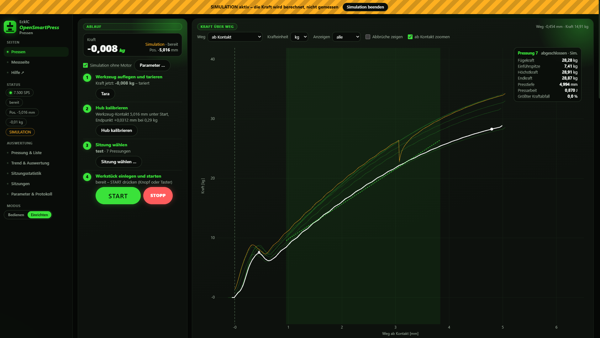
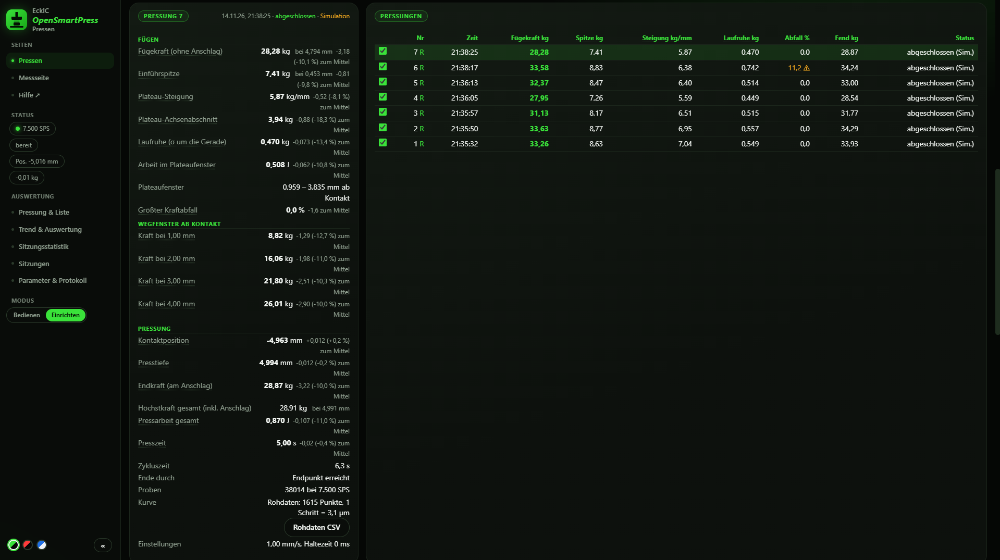
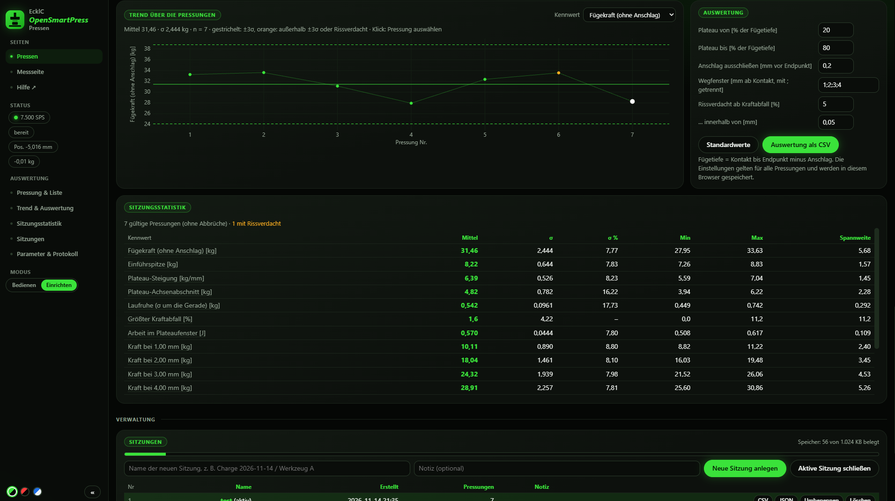
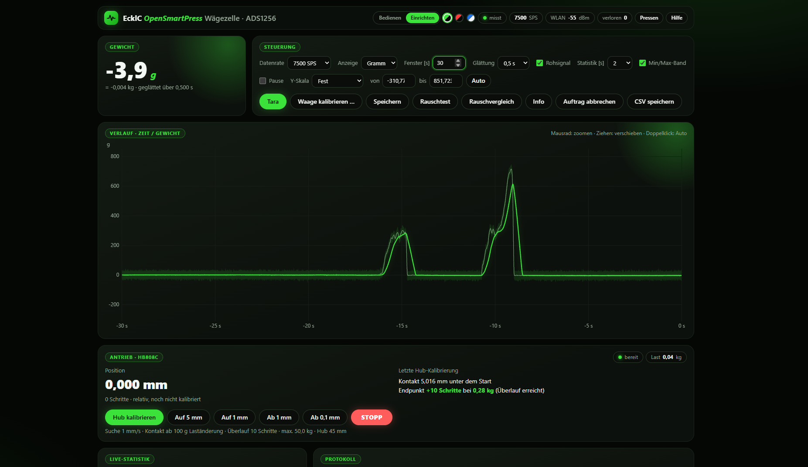

# OpenSmartPress

[English](README.en.md) · **Deutsch**

Präzise Kraft- und Gewichtsmessung mit einer 50-kg-Wägezelle, einem 24-Bit-ADC **ADS1256** und einem
**Raspberry Pi Pico W**. Die Messwerte erscheinen live im Browser über WLAN und über USB auf dem PC.
Datenraten von 2,5 bis 30 000 Messungen pro Sekunde lassen sich im Betrieb umschalten.

> Status: Testaufbau. Firmware und Weboberfläche laufen, Einstellungen und Grenzwerte sind auf den
> unten beschriebenen Aufbau zugeschnitten.

**Video:** OpenSmartPress im Einsatz (Klick auf das Bild öffnet YouTube)

[](https://www.youtube.com/watch?v=wHO0QPex5B8)

## Funktionen

- **Dauerbetrieb des ADS1256** (RDATAC) mit DRDY-Interrupt auf einem eigenen Prozessorkern, SPI mit 1,9 MHz,
  Ringpuffer für 4096 Messwerte. Verlorene Werte werden gezählt und angezeigt.
- **Weboberfläche** direkt vom Pico: Gewichtsanzeige, Live-Diagramm Zeit/Gewicht mit Min/Max-Band,
  Live-Statistik, Protokoll und Befehlszeile, auf **Deutsch oder Englisch** (Umschalter DE/EN). Erklärungen und
  Einstelltipps stehen in [help.md](help.md) (englisch: [help.en.md](help.en.md)).
- **Glättung** als gleitender Mittelwert über eine frei wählbare Zeit (0–60 s), unabhängig von der Datenrate.
- **Tara und Kalibrierung** mit Plausibilitätsprüfung (Empfindlichkeit in mV/V, Unsicherheit des Faktors).
- **Rauschanalyse**: Standardabweichung in Counts, µV und Gramm, effektive und rauschfreie Auflösung,
  Streuung nach Mittelung auf 10 SPS. Mit `nv` werden mehrere Datenraten automatisch verglichen.
- **Überwachung**: Warnung ab 100 % Nennlast, Alarm ab 120 % (LED), Erkennung eines übersteuerten ADC.
  Ein Sensorfehler (Messwert am Anschlag oder eingefroren) stoppt und sperrt jede Abwärtsfahrt.
- **PC-Programm** `tools/waegezelle_plot.py` für die Aufzeichnung jedes einzelnen Messwerts über USB.
- Einstellungen (Tara, Faktor, Glättung, Datenrate, Antrieb) bleiben im Flash gespeichert, stromausfallsicher
  in der Datei `/einst.bin` (LittleFS).

## Hardware

| Teil | Typ / Wert |
|---|---|
| Mikrocontroller | Raspberry Pi Pico W bzw. WH (RP2040) |
| ADC | ADS1256-Modul, 7,68-MHz-Quarz, Referenz ADR03 (2,5 V), 5 V Versorgung, 3,3-V-Logik |
| Wägezelle | 50 kg, Flachmembran, 350-Ω-Vollbrücke, 1,0–2,0 mV/V |
| Brückenspeisung | 5,00 V aus einem LT3042 (rauscharmer Linearregler) |

Datenblattwerte der Teile und was sie für diesen Aufbau bedeuten: [docs/hardware.md](docs/hardware.md).

### Verdrahtung

Plan als Grafik: [docs/Verdrahtung_PicoWH_ADS1256.svg](docs/Verdrahtung_PicoWH_ADS1256.svg)

| Pico | ADS1256 | Funktion |
|---|---|---|
| GP18 | SCLK | SPI0 Takt |
| GP19 | DIN | SPI0 TX |
| GP16 | DOUT | SPI0 RX |
| GP17 | CS | Chip Select (als GPIO) |
| GP20 | DRDY | Daten bereit |
| GP21 | PDWN | Power-Down (optional) |
| VBUS / GND | 5V / GND | Versorgung |

| Wägezelle | Anschluss |
|---|---|
| Rot | +5,00 V (LT3042) |
| Schwarz | GND |
| Grün | AIN0 |
| Weiß | AIN1 |

Messung differenziell AIN0–AIN1, Eingangspuffer an, PGA 64: Messbereich ±78,125 mV, 1 Count = 9,313 nV.

### Antrieb

Nema-23-Closed-Loop-Schrittmotor mit Treiber **HB808C** (PUL/DIR, 24–80 V, Signaleingänge 4,5–28 V), Hub 45 mm,
„ab“ = Rechtslauf.

| Pico | Anschluss | Hinweis |
|---|---|---|
| GP2 | PUL | über 5-V-Pegelwandler (z. B. 74AHCT125) oder Transistor, 3,3 V reichen nicht |
| GP3 | DIR | wie PUL |
| GP4 | ENA | empfohlen (`mp ena`), über den Not-Aus-Kreis führen |
| GP5 | ALM | optional, Alarmausgang des Treibers (`mp alm`) |
| GP6 | START-Taster gegen GND | startet eine Pressung (wenn alles bereit ist) |
| GP7 | STOPP-Taster gegen GND | hält sofort an (Software, kein Not-Aus) |
| GP10 / GP11 | Encoder EA+ / EB+ (nur Prüfbefehl `enc`) | je über Spannungsteiler 10 kΩ / 20 kΩ nach GND (5 V → 3,3 V), GND an EGND; nach dem Test wieder abklemmen |

Ein Nema 23 an einer Spindel kann ein Vielfaches der 50 kg Nennlast drücken. Die Kraftgrenze im Pico ist schnell,
ersetzt aber keinen **Not-Aus** und keinen mechanischen Anschlag.

**Not-Aus (Pflicht für den Betrieb):** Der STOPP-Taster an GP7 wird von der Firmware abgefragt. Hängt die Firmware
oder ist Kern 1 gerade mit dem ADC beschäftigt (Selbstkalibrierung, bis ca. 3 s), wirkt er nicht. Ein Not-Aus muss
deshalb **fest verdrahtet** und unabhängig vom Pico sein (EN ISO 13850, Auslegung nach EN ISO 13849-1):

- Not-Aus-Taster (rastend, Öffner, zwangsöffnend) in Reihe mit der Spule eines Sicherheitsrelais bzw. Schützes.
- Das Schütz trennt die Versorgung des HB808C (24–80 V). Zusätzlich ENA über einen zweiten Öffnerkontakt führen,
  damit der Treiber auch bei klebendem Schütz gesperrt ist; in der Firmware dann `mp ena 1` bzw. `2`.
- Nach dem Entriegeln darf der Motor nicht von selbst anlaufen: Das Schütz zieht erst über einen separaten
  Freigabe-Taster wieder an (Selbsthaltung). Danach Hub neu kalibrieren, die Position ist unbekannt.
- Ohne ENA erinnert die Firmware bei der ersten Fahrt nach dem Einschalten daran.

**Für wenig Rauschen:** ADS1256-Modul ebenfalls aus dem LT3042 versorgen, Sternmasse am AGND des ADS1256,
Signalleitungen Grün/Weiß verdrillen und vom Pico fernhalten. Den Einfluss des WLAN-Funks kannst du mit
`wlan aus` / `wlan an` und einem Rauschvergleich messen.

## Software einrichten

1. **Arduino IDE** installieren und den Core **„Raspberry Pi Pico/RP2040/RP2350“ von Earle Philhower**
   über den Boardverwalter hinzufügen (entwickelt mit Version 6.3.2). Weitere Bibliotheken sind nicht nötig.
2. Repository klonen. Der Ordner muss `Waegezelle_Test` heißen, damit die Arduino IDE den Sketch öffnet.
   ```
   git clone https://github.com/EggCe/OpenSmartPress.git Waegezelle_Test
   ```
3. `wlan_zugang.beispiel.h` nach **`wlan_zugang.h`** kopieren und SSID und Passwort eintragen
   (nur 2,4-GHz-Netze). Diese Datei wird nicht ins Repository übernommen.
4. `Waegezelle_Test.ino` öffnen, Board **„Raspberry Pi Pico W“** und unter *Werkzeuge → Flash Size*
   **„2MB (Sketch: 1MB, FS: 1MB)“** wählen, dann hochladen. Im Dateisystem liegen die Sitzungen; die
   gespeicherten Einstellungen bleiben beim Umstellen erhalten. Mit arduino-cli:
   ```
   arduino-cli compile --upload -p COM5 --fqbn rp2040:rp2040:rpipicow:flash=2097152_1048576 .
   ```
5. Seriellen Monitor öffnen (Zeilenende „Neue Zeile“). Nach dem Start erscheint die Adresse der Weboberfläche:
   ```
   # WLAN verbunden: http://192.168.x.x  bzw. http://waegezelle.local
   ```

## Bedienung

### Weboberfläche

| Adresse | Inhalt |
|---|---|
| `http://waegezelle.local/presse` | **Pressseite** (Produktion): Ablauf, Kraft-Weg-Diagramm, Kennwerte, Sitzungen |
| `http://waegezelle.local/` | Messseite (Service): Gewicht, Diagramm, Statistik, Protokoll, Befehle |

Funktioniert `waegezelle.local` nicht, die IP-Adresse aus dem seriellen Monitor verwenden. Die Seiten liegen
im Flash des Pico und brauchen kein Internet. Der Knopf „Hilfe“ öffnet [help.md](help.md) (englisch
[help.en.md](help.en.md)) auf GitHub (dafür ist Internet nötig): alle Regler und Kennzahlen erklärt, Einstelltipps,
Kalibrierablauf.

**Sprache:** Beide Seiten haben einen Umschalter **DE / EN** (Messseite oben rechts, Pressseite im Menü links). Die
Wahl wird im Browser gespeichert und gilt für beide Seiten; ohne Wahl entscheidet die Browsersprache. Umgeschaltet
wird sofort ohne Neuladen, also auch während der Antrieb fährt. Zahlen- und Datumsformat folgen der Sprache, ebenso
die CSV-Exporte des Browsers (Deutsch: `;` und Dezimalkomma, Englisch: `,` und Dezimalpunkt). Protokoll,
Rückmeldungen des Pico und der Sitzungsexport des Pico (`/sitzung/export`) bleiben deutsch.

Beide Seiten haben die Ansicht **Bedienen / Einrichten** (im Browser gespeichert, neuer Browser = Bedienen):
Bedienen zeigt nur Tara, Hub kalibrieren, Sitzung, START/STOPP, Diagramm und Auswertung; Einrichten zusätzlich
Datenrate, Rauschtests, Waage kalibrieren (Dialog), Speichern, Tippbetrieb, Simulation, Pressparameter
(inkl. Maximalkraft/Kontakt), Protokoll und Befehlszeile. Kein Zugriffsschutz. Solange der Antrieb fährt, steht
unten eine STOPP-Leiste; Antworten und Fehler des Pico erscheinen kurz unten rechts; ohne Verbindung sperrt ein
roter Balken die Befehlsknöpfe (außer STOPP).

**Pressseite – Ablauf und Kraft-Weg-Diagramm** (hier in der Simulation, ausgerichtet ab Kontakt, mit
Plateaufenster, Plateau-Gerade und einer Pressung mit Rissverdacht):



**Pressseite – Kennwerte der ausgewählten Pressung und Liste aller Pressungen der Sitzung:**



**Pressseite – Trend eines Kennwerts mit ±3σ, Auswertungseinstellungen, Sitzungsstatistik und Sitzungen:**



**Messseite – Gewicht, Steuerung, Verlauf Zeit/Gewicht mit Min/Max-Band und Antrieb:**



**Empfohlene Grundeinstellung zum Wiegen:** 2000 SPS, Glättung 0,5 s, Statistik 2–5 s.

### Erste Schritte

1. Gerät 15–30 Minuten warmlaufen lassen.
2. Zelle entlasten, **Tara** drücken (oder `t`).
3. Bekanntes Gewicht mittig auflegen, möglichst 5 kg oder mehr, dann kalibrieren: `k 5000 10000`
   (Gewicht in Gramm, Anzahl Messwerte).
4. Mit `s` speichern.

### Befehle

Im Eingabefeld der Weboberfläche oder im seriellen Monitor. `h` zeigt alle Befehle.

| Befehl | Funktion |
|---|---|
| `t [n]` | Tara aus n Messwerten |
| `k <g> [n]` | Kalibrieren mit bekanntem Gewicht in Gramm |
| `f <c/g>` | Kalibrierfaktor direkt setzen (Counts pro Gramm) |
| `r <sps>` | Datenrate: 2.5 5 10 15 25 30 50 60 100 500 1000 2000 3750 7500 15000 30000 |
| `fl <s>` | Glättung in Sekunden (0 = aus) |
| `ws <s>` | Dauer der Live-Statistik im Web |
| `n [n]` | Rauschanalyse |
| `nv [s] [sps …]` | Rauschvergleich mehrerer Datenraten |
| `m <0..4>` | USB-Ausgabe: 0 aus, 1 lesbar, 2 CSV, 3 Arduino-Plotter, 4 binär |
| `wlan [an\|aus]` | WLAN-Status bzw. ein-/ausschalten |
| `wd` / `wd test 0\|1` | Watchdog-Status / Kern 0 bzw. 1 zum Test aufhängen (löst Neustart aus) |
| `enc` / `enc 0` / `enc aus` | Encoder-Test: Quadratur an GP10/GP11 mitzählen (1 Umdrehung = 4 × Strichzahl) / Zähler null / beenden |
| `i` / `d` / `c` | Status / Register des ADS1256 / Selbstkalibrierung des ADC |
| `s` | Einstellungen im Flash speichern |
| `x` | Laufenden Auftrag abbrechen |
| `init` | ADS1256 neu initialisieren |
| `w ja` | Werkseinstellungen (löscht Tara und Kalibrierung) |

### Antrieb einrichten und Endpunkt kalibrieren

1. `mp spmm <Schritte pro mm>` setzen (Mikroschritte pro Umdrehung × Übersetzung / Spindelsteigung, z. B. 320).
   Vorher bewegt sich der Motor nicht.
2. Waage kalibriert, Datenrate 2000 SPS. Unter 500 SPS oder ohne kalibrierten Faktor fährt der Antrieb nicht.
3. Richtung prüfen: `mot ab 1` muss nach unten fahren, sonst `mp dir 0`/`1`. Weg mit `mot ab 10` nachmessen.
4. Erste Fahrten mit kleiner Kraftgrenze: `mp fmax 2000`. Mit `s` speichern.
5. **Endpunkt-Kalibrierung** (Hub kalibrieren) mit dem Webknopf oder `mot kal`, Werkzeug liegt auf der Zelle:
   - langsam abwärts, bis die Last um mehr als 100 g steigt: **Werkzeug-Endpunkt** = neuer Nullpunkt,
   - weiter bis Kontakt + 10 Schritte oder bis 50 kg (was zuerst kommt): **tatsächlicher Endpunkt**,
   - zurück zur Startposition bzw. mit `mp kalrueck <mm>` auf so viele mm über den Werkzeug-Endpunkt
     (0 = Startposition, höchstens der nutzbare Hub `mp hub`, auch über der Startposition); Kontakttiefe, Endpunkt, Kraft und Steifigkeit stehen im Protokoll.

Während jeder Abwärtsfahrt prüft Kern 1 jeden Messwert im ADC-Interrupt und stoppt innerhalb eines Schritts.
Stopp jederzeit mit `x`, der Esc-Taste im Browser, dem STOPP-Knopf oder dem STOPP-Taster.

| Befehl | Funktion |
|---|---|
| `mot` | Status, Position, letzte Kalibrierung |
| `mot kal` | Endpunkt-Kalibrierung (Hub kalibrieren) |
| `mot ab <mm>` / `mot auf <mm>` / `mot s <n>` | Tippbetrieb |
| `mot null` / `mot ein` / `mot aus` | Position 0 setzen, Motorstrom ein/aus |
| `mp` / `mp <name> <wert>` | Parameter anzeigen/setzen: `spmm dir inv ena alm vsuch vfahrt acc hub ueber kontakt fmax kalrueck anfahrt vpress vanfahrt vrueck halt` |

### Pressen (Produktion)

Auf der Pressseite `http://waegezelle.local/presse`:

1. **Werkzeug auflegen und tarieren** – das Werkzeuggewicht wird abgezogen.
2. **Hub kalibrieren** (ohne Werkstück, nach jedem Einschalten nötig): Werkzeug-Endpunkt = Weg 0, dazu der
   tatsächliche Endpunkt (Kontakt + `ueber` Schritte bzw. `fmax`).
3. **Sitzung wählen oder anlegen.**
4. **Werkstück einlegen, START** (Knopf auf der Seite, START-Taster oder `pr`): mit `vanfahrt` (Standard 3 mm/s) bis `anfahrt` mm (Standard 5,
   höchstens 45 mm, so knapp über dem Werkstück wie möglich) über dem
   Werkzeug-Endpunkt, mit `vpress` bis zum **kalibrierten Endpunkt** (früher bei `fmax`), `halt` ms halten, mit `vrueck` (Standard 3 mm/s) zurück.

Jede Pressung wird als Kurve **Kraft über Weg** gezeichnet und sofort im Flash gespeichert (ca. 200 Pressungen).
Alle Pressungen einer Sitzung liegen übereinander; ein Klick auf eine Kurve oder Tabellenzeile zeigt Spitzenkraft,
Endkraft, Kontakt, Presstiefe, mittlere Kraft, Standardabweichung, Spannweite, Pressarbeit und Zeiten, jeweils mit
Abweichung zum Mittel der Sitzung. Die Sitzungsstatistik fasst Mittel, σ und Spannweite aller Kennwerte zusammen.
Sitzungen lassen sich anlegen, öffnen, umbenennen, löschen und als **CSV** (Excel: Semikolon, Dezimalkomma) oder
**JSON** exportieren. Abgebrochene Pressungen werden markiert gespeichert und zählen nicht zur Statistik.
**Auswertung** (im Browser aus den gespeicherten Kurven, Einstellungen auf der Seite):
Kurven wahlweise **ab Kontakt** ausgerichtet; **Fügekraft** ohne den Anschlag am Endpunkt; **Einführspitze**;
**Plateau-Gerade** im einstellbaren Fenster (Steigung, Achsenabschnitt, **Laufruhe** = Streuung um die Gerade, Arbeit);
**größter Kraftabfall** mit Markierung **Rissverdacht** (Standard ab 5 % in 0,05 mm); **Kraft in Wegfenstern** ab
Kontakt; **Trenddiagramm** eines Kennwerts über die Pressungen mit ±3σ. „Auswertung als CSV“ exportiert alles.
In der Simulation haben die Kurven eine Einführspitze, und etwa jede zwölfte Pressung bekommt einen Riss.

Die **Krafteinheit** ist über dem Diagramm wählbar (**N, kg, lbs**) und gilt für Diagramm, Kennwerte, Statistik und
den CSV-Export; der Browser merkt sich die Wahl. Gespeichert wird immer in N, der JSON-Export bleibt in N.
Mit **Achsen …** lassen sich Bereich (Auto oder fest von/bis) und Raster (Abstand der Gitterlinien) für Weg und
Kraft getrennt einstellen.

**Auflösung der Kurve:** Der Pico speichert höchstens 960 Wegabschnitte über den Pressweg (Kraft je Abschnitt
gemittelt). Ist die Pressseite während der Pressung offen, holt der Browser zusätzlich **jeden einzelnen Messwert**
(`GET /presse/roh`, alle 100 ms; Puffer im Pico 4096 Werte ≈ 2 s bei 2000 SPS) und speichert ihn in seiner
IndexedDB. Daraus entsteht eine Kurve mit einem Punkt je Motorschritt (z. B. 3,1 µm bei 320 Schritten/mm), die für
die ausgewählte Kurve, die Auswertung und den Download „Rohdaten CSV“ (Zeit, Weg, Kraft, Phase inkl. Haltezeit)
benutzt wird. Pressungen mit Rohdaten sind in der Tabelle mit **R** markiert. Ohne Rohdaten (Seite war zu,
WLAN-Lücke länger als der Puffer, anderer Browser) gilt die Pico-Kurve. Details in [help.md](help.md#auflösung-der-kurve).

**Simulation ohne Motor:** `sim an` (oder Schalter auf der Pressseite). Die Schrittimpulse laufen ins Leere, die
Position zählt trotzdem; die Kraft wird aus der Position berechnet: ein virtuelles Werkzeug (Standard 15 mm unter
der aktuellen Position) und je Pressung ein virtuelles Werkstück (Standard 3 mm hoch) mit zufälliger Spitzenkraft
(Standard **25–35 kg**) plus Rauschen. Alle Werte (Pressgeschwindigkeit, Werkzeugabstand, Fügeweg, Kraftbereich,
Rauschen, Rissquote, Einführspitze) lassen sich im Fenster **„Parameter …“** neben dem Schalter einstellen oder mit
`sim par` / `sim <name> <wert>`; der Browser merkt sie sich, der Pico nur bis zum Neustart. ADC und Wägezelle müssen angeschlossen sein (sie geben den Takt vor),
`mp spmm` muss gesetzt sein, eine Kalibrierung der Waage ist nicht nötig. Danach wie gewohnt Hub kalibrieren und
pressen. Simulierte Pressungen sind in Tabelle und Export markiert. Die
Simulation ist nach jedem Neustart aus.

Voraussetzungen für START: ADC misst mit mindestens 500 SPS, Waage kalibriert, Hub seit dem Einschalten kalibriert,
Sitzung aktiv, genug Speicher, Antrieb steht über dem Endpunkt. Fehlt etwas, nennt die Seite den Grund.

| Befehl | Funktion |
|---|---|
| `pr` / `pr x` | Pressung starten / abbrechen |
| `sim an` / `sim aus` | Simulation ohne Motor (siehe unten) |
| `sim par` / `sim <name> <wert>` | Simulationsparameter: `werkzeug weg fmin fmax rauschen riss spitze` |
| `sit` | Sitzungen und Speicherbelegung anzeigen |
| `sit neu <Name>` / `sit wahl <Nr>` / `sit zu` | Sitzung anlegen / öffnen / schließen |
| `sit loeschen <Nr> ja` | Sitzung löschen |
| `mp anfahrt <mm>` / `mp vpress <mm/s>` / `mp halt <ms>` | Anfahrpunkt (0–45 mm, Standard 5), Pressgeschwindigkeit, Haltezeit (danach `s`) |
| `mp vanfahrt <mm/s>` / `mp vrueck <mm/s>` | Pressen: Anfahrt bis zum Anfahrpunkt und Rückfahrt (0,1–50 mm/s, Standard je 3) |

### Aufzeichnung am PC über USB

Die Weboberfläche zeigt 50 zusammengefasste Punkte pro Sekunde. Für jeden einzelnen Messwert das PC-Programm
verwenden. Es schaltet die Firmware in den Binärmodus und zeichnet auf Wunsch in eine CSV-Datei auf.

```
pip install pyserial numpy pyqtgraph PyQt5
python tools/waegezelle_plot.py                 # Port wird automatisch gesucht
python tools/waegezelle_plot.py --port COM5 --rate 2000 --fenster 10
```

Der serielle Monitor muss dabei geschlossen sein. Weboberfläche und PC-Programm können gleichzeitig laufen.

## Beispielmessung: Rauschen nach Datenrate

Unbelastete Zelle in der Presse, Motor eingeschaltet (stehend), WLAN an, PGA 64, Faktor 11,62 Counts/g, je 3 s
(Rauschvergleich der Weboberfläche bzw. `nv`):

| SPS | σ Einzelwert | σ nach Mittelung auf 10 SPS | effektive Auflösung |
|---:|---:|---:|---:|
| 100 | 33,0 Counts (2,84 g) | 0,75 g | 19,0 Bit |
| 500 | 48,8 Counts (4,20 g) | 0,58 g | 18,4 Bit |
| 1000 | 63,0 Counts (5,42 g) | 0,49 g | 18,0 Bit |
| 2000 | 78,2 Counts (6,73 g) | 0,52 g | 17,7 Bit |
| 3750 | 106,8 Counts (9,19 g) | 0,42 g | 17,3 Bit |
| 7500 | 143,5 Counts (12,35 g) | 0,47 g | 16,8 Bit |
| 15000 | 181,7 Counts (15,64 g) | 0,40 g | 16,5 Bit |
| 30000 | 210,3 Counts (18,10 g) | 0,62 g | 16,3 Bit |

Bei hoher Datenrate ist jeder einzelne Wert unruhiger, nach dem Mitteln sind 500–15000 SPS aber gleich genau
(0,4–0,5 g, Unterschiede innerhalb der Unsicherheit eines 3-s-Laufs). Gegenüber einer früheren Messung ohne Motor
(Faktor 10,06) ist das Rauschen ab 1000 SPS in Counts nur 3–6 % höher: der eingeschaltete Treiber stört kaum.
Die Werte hängen stark von Aufbau, Versorgung und Umgebung ab.

## Aufbau der Software

Die beiden Kerne des RP2040 teilen sich die Arbeit:

| Kern | Aufgaben |
|---|---|
| Kern 1 | Alle Zugriffe auf den ADS1256: Initialisierung, Datenrate, Kalibrierung, DRDY-Interrupt. Jeder Messwert kommt mit laufender Nummer und Zeitstempel in einen Ringpuffer. Außerdem der Antrieb: Schritterzeugung per PWM, Rampen, Ablauf der Endpunkt-Kalibrierung, Kraftüberwachung im ADC-Interrupt, Taster und Alarmeingang. |
| Kern 0 | Verarbeitung (Glättung, Statistik, Überwachung, Tara/Kalibrierung), USB, WLAN und Webserver. Aufträge an den ADC gehen über ein Postfach an Kern 1. |

WLAN-Code darf im arduino-pico-Core ohne FreeRTOS nur auf Kern 0 laufen, daher diese Aufteilung.

Der Programmcode liegt in `src/`; die Arduino IDE übersetzt diesen Ordner automatisch mit.

```
Waegezelle_Test/
├── Waegezelle_Test.ino        setup/loop (Kern 0) und setup1/loop1 (Kern 1)
├── wlan_zugang.beispiel.h     Vorlage für wlan_zugang.h (WLAN-Zugangsdaten)
├── src/
│   ├── konfig.h               Pins, Referenz, Nennlast, Grenzwerte
│   ├── adc.*                  ADS1256-Objekt, Postfach Kern 0 → Kern 1, Init, Datenrate
│   ├── verarbeitung.*         Messwerte abholen, Überlast-/Übersteuerungswarnung, DRDY-Timeout
│   ├── filter.*               Glättung (gleitender Mittelwert über eine Zeit)
│   ├── statistik.h            Welford-Statistik, Ergebnis einer Rauschmessung
│   ├── auftraege.*            Tara, Kalibrierung, Rauschanalyse, Rauschvergleich
│   ├── usb_ausgabe.*          Ausgabemodi lesbar/CSV/Plotter/binär, #CFG-Zeile
│   ├── befehle.*              Befehle aus seriellem Monitor und Weboberfläche
│   ├── motor.*                Antrieb auf Kern 0: Parameter, Sicherheitsprüfungen, Meldungen
│   ├── einstellungen.*        Einstellungen im Flash (/einst.bin, Rückfall EEPROM): Tara, Faktor, Antrieb
│   ├── meldung.*              Meldungen an USB und Web-Protokoll
│   ├── pruefsumme.*           CRC-32 (Flash) und CRC-8 (Binärrahmen)
│   ├── rahmen.h               USB-Binärrahmen (Modus 4)
│   ├── welford.h              Welford-Statistik (Mittelwert, Streuung)
│   ├── watchdog.*             Hardware-Watchdog für Kern 0, Herzschlag-Überwachung von Kern 1, Stapelbelegung
│   ├── presse.*               Pressvorgang: Startprüfung, Kraft-Weg-Kurve, Kennwerte
│   ├── sitzungen.*            Sitzungen und Pressungen im Flash (LittleFS)
│   ├── treiber/
│   │   ├── ADS1256.*          RDATAC-Dauerbetrieb, Interrupt (im RAM), Ringpuffer, Lückenerkennung
│   │   ├── Antrieb.*          HB808C: PWM-Schritte, Rampen, Endpunkt-Kalibrierung, Kraftüberwachung
│   │   └── SensorWaechter.h   Sensorfehler: Messwert übersteuert oder eingefroren
│   └── web/
│       ├── wlan.*             WLAN-Verbindung, mDNS
│       ├── webserver.*        HTTP-Routen, JSON für /daten
│       ├── presse_web.cpp     Routen der Pressseite, Sitzungen, Export
│       ├── livedaten.*        Diagrammpunkte und Live-Statistik
│       └── seiten/            webui.h (Messseite), presse.h (Pressseite), webstil.h, sprache.h (DE/EN)
├── tools/waegezelle_plot.py   PC-Programm für Live-Anzeige und Aufzeichnung über USB
├── tools/motortest/          eigener Sketch nur für den Antrieb (Fehlersuche, OHNE Kraftüberwachung;
│                             Befehle über seriellen Monitor/Plotter, 'h' = Hilfe)
├── tools/sprache_pruefen.py   prüft, ob jeder Text der Weboberfläche eine englische Übersetzung hat
├── tests/host/                Tests der hardwareunabhängigen Logik auf dem PC (sh tests/host/run.sh)
├── .github/workflows/         CI: Tests, Übersetzungen, Übersetzen ohne Warnungen, RAM-Grenze
└── docs/                      Verdrahtungsplan, Hardwaredaten (hardware.md / hardware.en.md)
```

### Datenformate

**USB, Binärmodus (`m 4`):** 8 Byte je Messwert

| Byte | Inhalt |
|---|---|
| 0–1 | Synchronwort `A5 5A` |
| 2–3 | laufende Nummer, uint16 little-endian (Lücke = verlorene Werte) |
| 4–6 | Messwert in Counts, int24 little-endian, Zweierkomplement |
| 7 | CRC-8 (Polynom 0x07, Startwert 0x00) über Byte 2–6 |

Textmeldungen beginnen immer mit `#` und können zwischen den Rahmen stehen. Die Zeile `#CFG …` enthält alle
Umrechnungsgrößen (Datenrate, µV pro Count, Tara, Faktor) und wird nach jeder Änderung gesendet:

```
Gramm = (Counts − tara) / faktor
µV    = Counts × uv_count
```

**USB, CSV-Modus (`m 2`):** `seq,t_us,roh` mit Ganzzahlen.

**HTTP:**

| Adresse | Inhalt |
|---|---|
| `GET /` / `GET /presse` | Messseite / Pressseite. Während der Antrieb fährt (Pressung, Kalibrierung, Fahrt) kommt stattdessen eine kurze Warteseite (503), die sich alle 2 s neu lädt: das Senden der ganzen Seite würde Kern 0 so lange blockieren, dass Proben der Pressung verloren gehen. Beide Seiten fragen vor dem Verlassen nach, solange der Antrieb fährt. |
| `GET /stil.css` / `GET /sprache.js` | gemeinsames Stylesheet / Sprachwahl mit den englischen Texten beider Seiten (5 min zwischengespeichert) |
| `GET /daten?p=<punkt>&l=<log>` | JSON: Konfiguration, Diagrammpunkte (Zeit, Mittel, Min, Max, geglättet), Statistik, neue Protokollzeilen |
| `POST /cmd` mit `c=<befehl>` | führt einen Befehl aus (Kopfzeile `X-Waegezelle: 1` nötig, siehe unten) |
| `GET /presse/status` | JSON: Bereitschaft, Antrieb, aktive Sitzung, Live-Kurve, Rohdatenstand, neue Protokollzeilen |
| `GET /presse/roh?id=&ab=` | binär: jede Probe der laufenden/letzten Pressung ab Probe `ab` (Kopf 48 Byte + 8 Byte je Probe, Format in `src/web/presse_web.cpp` und `src/presse.h`) |
| `GET /sitzungen` | JSON: alle Sitzungen und Speicherbelegung |
| `GET /sitzung/index?id=` / `GET /sitzung/presse?id=&nr=` | binär: Köpfe aller Pressungen / eine Pressung (Format in `src/sitzungen.h`) |
| `GET /sitzung/export?id=&f=csv\|json` | Export zum Herunterladen |
| `POST /sitzung` mit `a=neu\|wahl\|zu\|aendern\|loeschen` | Sitzungen verwalten (Kopfzeile `X-Waegezelle: 1`) |
| `POST /zeit` mit `t=<unix>&tz=<min>` | Uhrzeit vom Browser (Kopfzeile `X-Waegezelle: 1`) |

Schreibende Anfragen (`POST /cmd`, `/sitzung`, `/zeit`) müssen die Kopfzeile `X-Waegezelle: 1` mitschicken, sonst
antwortet der Pico mit 403. Ein Browser setzt eine solche Kopfzeile für eine fremde Webseite nur nach einer
CORS-Vorabfrage, die der Pico nie erlaubt. So kann keine andere Webseite (Link, Bild, Formular) einen Befehl oder
eine Fahrt auslösen. Von der Kommandozeile:

```
curl -X POST -H "X-Waegezelle: 1" --data "c=i" http://waegezelle.local/cmd
```

## Hinweise

- Die Weboberfläche hat **keinen Passwortschutz**. Jeder im selben WLAN kann tarieren, kalibrieren, die
  Datenrate ändern und den Antrieb fahren. Die Kopfzeile `X-Waegezelle` schützt nur vor fremden Webseiten im
  Browser, nicht vor Programmen im Netz. Die Presse daher nur in einem eigenen, vertrauenswürdigen WLAN betreiben.
- Beim Speichern (`s`) und bei Ratenwechseln gehen kurz Messwerte verloren; sie werden gezählt.
- `wlan aus` lässt sich nur über USB rückgängig machen.
- **Watchdog:** Hängt Kern 0 länger als 8 s, startet der Pico neu. Kern 1 meldet sich ständig mit einem
  Herzschlag; bleibt er länger als 1 s aus, sperrt Kern 0 sofort die Schrittimpulse und startet neu. Nach so einem
  Neustart steht eine Warnung im Protokoll, `wd` zeigt den Grund. Ungespeicherte Tara/Kalibrierung geht dabei verloren.
  `wd` zeigt außerdem, wie viel Stapel jeder Kern seit dem Start höchstens belegt hat.
- **Einstellungen speichern (`s`):** Die Firmware schreibt `/einst.neu`, liest sie zurück und benennt sie auf
  `/einst.bin` um. Ein Stromausfall dabei hinterlässt immer die alte oder die neue Fassung. Ältere Firmware
  speicherte im EEPROM-Bereich; diese Werte werden beim ersten Start übernommen und mit `s` in die Datei geschrieben.
- **Tests:** `sh tests/host/run.sh` (braucht g++, unter Windows z. B. in WSL) prüft CRC, Binärrahmen, Statistik und
  die Sensorfehler-Erkennung auf dem PC. `python tools/sprache_pruefen.py` prüft, ob jeder Text der Weboberfläche
  eine englische Übersetzung hat. Die GitHub-Action `.github/workflows/firmware.yml` führt diese Prüfungen aus und
  übersetzt die Firmware; sie schlägt bei Compiler-Warnungen oder mehr als 224 000 Byte statischem RAM fehl.

## Lizenz

Noch nicht festgelegt.
